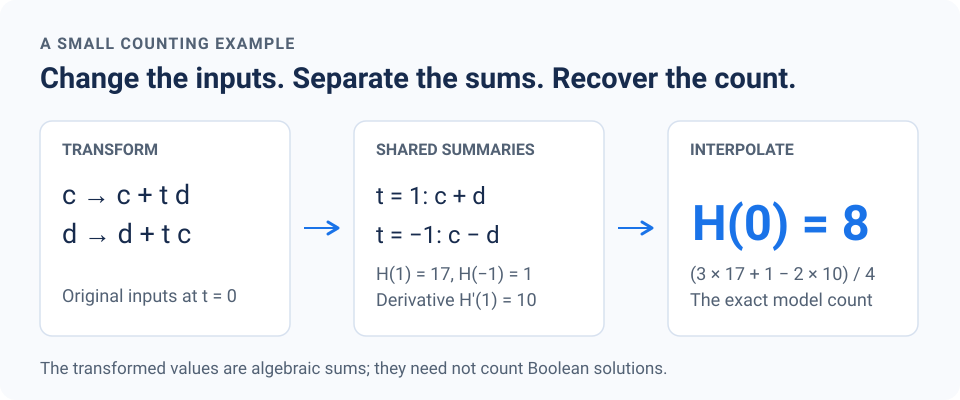

What caught my attention in OpenAI's new [ETH preprint][eth] was that the algorithm counts satisfying assignments exactly. Deciding satisfiability then follows by checking whether the count is positive. Theorem 1.1 states a deterministic, subexponential-time algorithm for every fixed clause width, using polynomial space.

I wanted to understand one part of the construction: **how can a few shared linear summaries make a counting problem easier?** The example below is a small illustration of the shared-summary and interpolation idea, with arithmetic we can check by hand.

The example starts with a formula that has **8** satisfying assignments. We will change its algebraic representation, compute the values **17** and **1** at two other points, and use a derivative to recover **8** exactly.

<figure class="post-figure post-figure--scientific">

<figcaption>The values at the easier points are algebraic sums. They need not be model counts.</figcaption>
</figure>

## Start with a small formula

Let

$$
F=(a\lor c)\land(b\lor d)\land(c\lor d).
$$

All four variables are Boolean. **This first example is a #2-SAT counting problem:** every clause has two literals. I chose it to keep the arithmetic small.

The distinction between decision and counting matters here. Deciding whether a 2-CNF formula is satisfiable takes polynomial time, but exactly counting its satisfying assignments, #2-SAT, is #P-complete; see the discussion in [Laakkonen, Meichanetzidis, and van de Wetering][graphical]. This makes it a useful setting for illustrating a counting method, although a toy example says nothing about a general #3-SAT runtime. The second example below has three distinct variables in every clause.

We can check the answer directly by fixing $c$ and $d$:

| $(c,d)$ | What remains for $(a,b)$? | Models |
|---|---|---|
| $(0,0)$ | The clause $c\lor d$ is false. | 0 |
| $(0,1)$ | $a=1$; $b$ is free. | 2 |
| $(1,0)$ | $b=1$; $a$ is free. | 2 |
| $(1,1)$ | Both $a$ and $b$ are free. | 4 |

Thus $\#F=0+2+2+4=8$. We will use this as a check on the algebra.

## Turn the clauses into polynomials

Define

$$
\begin{aligned}
\phi(a,z)&=a+(1-a)z,\\
v(c,d)&=c+d-cd.
\end{aligned}
$$

On Boolean inputs, these are the indicators of $a\lor z$ and $c\lor d$. Consequently,

$$
\#F=\sum_{a,b,c,d\in\{0,1\}}
\phi(a,c)\,\phi(b,d)\,v(c,d).
$$

So far this is only a different expression for the same count. There are still 16 assignments in the sum.

Now introduce a parameter $t$. In the first clause, replace $c$ by $c+td$. In the second, replace $d$ by $d+tc$. Leave the third clause unchanged:

$$
H(t)=\sum_{a,b,c,d\in\{0,1\}}\Big[\phi(a,c+td)\cdot\phi(b,d+tc)\,v(c,d)\Big].
$$

At $t=0$, both replacements restore the original inputs, so

$$
H(0)=\#F.
$$

Also, **$H$ has degree at most two**: each of the first two factors is linear in $t$, and the third does not depend on $t$. That degree bound will let us reconstruct $H(0)$ from other information about $H$.

## At $t=1$, only a shared sum matters

Split the variables into two groups:

$$
A=\{a,b\},\qquad B=\{c,d\}.
$$

At $t=1$, both transformed inputs become the same quantity:

$$
c+td=c+d,\qquad d+tc=c+d.
$$

Call that quantity $s=c+d$. The first two factors can now use $s$ without knowing $c$ and $d$ individually. This is the shared summary in our example.

For a fixed $s$, the contribution from group $A$ is

$$
\begin{aligned}
A(s)
&=\sum_{a,b}\phi(a,s)\phi(b,s)\\
&=\left(\sum_a\phi(a,s)\right)
  \left(\sum_b\phi(b,s)\right)\\
&=(1+s)^2.
\end{aligned}
$$

Meanwhile, group $B$ counts its assignments with that summary that satisfy the unchanged clause $c\lor d$. Write this number as $B(s)$.

| Summary $s$ | $B(s)$ | $A(s)$ | Product |
|---|---:|---:|---:|
| 0 | 0 | 1 | 0 |
| 1 | 2 | 4 | 8 |
| 2 | 1 | 9 | 9 |

Multiplying the contributions from the two groups and summing over summaries gives

$$
H(1)=\sum_{s=0}^{2}A(s)B(s)=17.
$$

Notice that the two assignments $(c,d)=(0,1)$ and $(1,0)$ are both counted. Sharing a summary does not mean discarding their multiplicity.

Also, **17 is not the number of satisfying assignments of a new Boolean formula**. Some transformed inputs are no longer Boolean. For example, when $c=d=1$, the input $s$ equals 2 and $\phi(0,2)=2$. We are evaluating a weighted algebraic sum.

## At $t=-1$, a shared difference works

At the other point, the transformed inputs become

$$
c-d=r,\qquad d-c=-r.
$$

Group $A$ only needs the summary $r=c-d$. Its summed contribution is

$$
(1+r)(1-r)=1-r^2.
$$

For $(c,d)=(0,1)$ or $(1,0)$, this contribution is zero because $r=\pm1$. The assignment $(0,0)$ is excluded by $c\lor d$. The remaining assignment $(1,1)$ has $r=0$ and contributes 1. Therefore,

$$
H(-1)=1.
$$

The two evaluation points use different summaries. Our substitutions were chosen by hand to make this happen.

## Recover the count with one derivative

Two values do not generally determine a quadratic. We need one more piece of information.

In this example, differentiating also leads to a small local calculation. After summing over $a$ and $b$, the summand for each $(c,d)$ is

$$
(1+c+td)(1+d+tc)\,v(c,d).
$$

Its derivative at $t=1$ is

$$
d(1+c+d)v(c,d)+c(1+c+d)v(c,d)=s(1+s)v(c,d).
$$

We can reuse the same multiplicities $B(s)$:

$$
\begin{aligned}
H'(1)
&=\sum_{s=0}^{2}B(s)s(1+s)\\
&=0+2\cdot2+1\cdot6=10.
\end{aligned}
$$

The plot below shows why the derivative matters. Two fixed values still allow many quadratic curves. The measured slope at $t=1$ selects the one whose value at $t=0$ is our model count.

<iframe src="/posts/counting-sat-with-shared-summaries/interpolation.html?v=2026-11-01-1" title="Interactive interpolation: two points and a slope determine the model count" width="100%" height="650" loading="lazy" style="display: block; border: 0; margin: 1.5rem 0;"></iframe>

At the measured slope, the tangent line reaches 7 at $t=0$. The quadratic correction adds 1, giving the exact count 8. Written around $t=1$, this is the Taylor expansion

$$
H(t)=17+10(t-1)+(t-1)^2.
$$

For any polynomial $H$ of degree at most two, the following identity holds:

$$
H(0)=\frac{3H(1)+H(-1)-2H'(1)}{4}.
$$

You can verify it by substituting $H(t)=u+wt+zt^2$: the coefficients of $w$ and $z$ cancel, leaving $u$.

Substituting our three computed quantities,

$$
\#F=H(0)
=\frac{3\cdot17+1-2\cdot10}{4}
=8.
$$

This is a small instance of Hermite interpolation: polynomial recovery using values and derivatives. It is exact. There is no statistical estimate or numerical approximation here.

As a final check, expanding the toy sum gives

$$
H(t)=8+8t+t^2.
$$

The [verification script](verify_example.py) checks the direct model count, the grouped calculations, the interpolation identity, and this polynomial using integer arithmetic. It enumerates all 16 assignments as an independent check; it is not an implementation of the paper's algorithm.

## A second check with three-literal clauses

To check that the arithmetic was not peculiar to the first example, I also used seven variables and seven clauses, each containing three distinct variables:

$$
\begin{aligned}
F_2={}&(a\lor\neg b\lor c)\\
&\land(\neg a\lor e\lor d)\\
&\land(b\lor\neg e\lor\neg c)\\
&\land(\neg b\lor f\lor\neg d)\\
&\land(a\lor b\lor e)\\
&\land(\neg a\lor\neg e\lor f)\\
&\land(c\lor\neg d\lor g).
\end{aligned}
$$

Direct enumeration of all 128 assignments gives:

| $(c,d)$ | Satisfying assignments of the other five variables |
|---|---:|
| $(0,0)$ | 8 |
| $(0,1)$ | 7 |
| $(1,0)$ | 10 |
| $(1,1)$ | 12 |
| **Total** | **37** |

For the algebraic check, put $A=\{a,b,e,f\}$ and $B=\{c,d,g\}$. Make the same substitutions $c\mapsto c+td$ and $d\mapsto d+tc$ in the first six clauses, leaving the last clause unchanged.

The [second verification script](verify_second_example.py) recovers the coefficients around $t=1$ by separately summing over each group, with inclusion–exclusion over restrictions on $c$ and $d$. It computes all coefficients through degree four, the degree bound before cancellation. The result is

$$
H(1+z)=30-15z-8z^2.
$$

Setting $z=-1$ restores the original inputs:

$$
\#F_2=H(0)=30+15-8=37.
$$

Thus the direct Boolean count and the grouped algebraic reconstruction agree on a different formula. The script also compares the grouped polynomial with direct algebraic evaluation at seven parameter values. The [DIMACS input](second-example.cnf) is available for checking with a separate model counter.

## What the example leaves out

The example shows a useful pattern: keep the desired count at one parameter value, compute algebraic sums at other values where groups interact through small summaries, and reconstruct the answer.

There is no performance claim here. The original formula is easy, the groups are tiny, and we chose convenient substitutions ourselves.

In the [paper's construction][eth], summaries take the form $y_g=C_gx_g$, with bounded integer coefficients. Its central challenge is obtaining few summaries, small groups, and low-degree replacements together. Sections 2.5 and 3 recover Taylor data through additional restricted sums and inclusion–exclusion; the simple derivative calculation above does not replace that machinery.

## How this relates to practical model counters

This is a different algorithmic mechanism from the ones in several of Kuldeep Meel's model-counting projects:

- **[ApproxMC][approxmc]** uses random XOR constraints to partition the solution space, bounded counting with SAT calls, and statistical analysis to obtain an approximation with an $(\varepsilon,\delta)$ guarantee.
- **[GANAK][ganak]** uses search, decomposition into independent components, and caching. Its “probabilistic exact” guarantee means that, except for a bounded probability of error associated with hashing, the returned count is exact. That is different from permitting a multiplicative approximation error.
- **[PBCount][pbcount]** uses algebraic decision diagrams and dynamic programming to combine constraints and sum out variables.

The closest conceptual connection I see is to decomposition and dynamic programming: once the right information is fixed, local contributions can be combined. That observation does not yet tell us how to make a useful hybrid.

For example, the value 17 in our toy calculation shows why an ordinary SAT counter cannot simply replace every inner sum without an appropriate encoding or a more general weighted computation. Approximate counts raise another question: subtraction in the reconstruction can amplify errors, so local approximation guarantees would need a separate analysis.

I would be interested in testing whether cheaper, instance-specific summaries help an existing exact counter, or whether a decision-diagram representation can evaluate the transformed group sums efficiently. Those are possible experiments, not results of this example.

For sampling, there is already a direct theoretical connection. Given exact counts $N_0$ and $N_1$ for the two choices of the next variable, choose 1 with probability $N_1/(N_0+N_1)$ and continue. Repeating this on a satisfiable formula gives a uniform satisfying assignment. The preprint notes this consequence on page 2. Whether the required counts can be obtained competitively on practical instances remains the question.

## Sources and scope

This post is a worked explanation of one mechanism, not an independent verification of the full ETH result. The worked example and verification script are my own.

1. **OpenAI.** [*The Exponential Time Hypothesis Is False*][eth], revised October 25, 2026. See Theorem 1.1 and Sections 2.2–2.7 and 3. The accompanying [research announcement][announcement] provides the release context.
2. **Supratik Chakraborty, Kuldeep S. Meel, and Moshe Y. Vardi.** [*Approximate Model Counting*][approxmc], *Handbook of Satisfiability*, second edition, 2021.
3. **Shubham Sharma, Subhajit Roy, Mate Soos, and Kuldeep S. Meel.** [*GANAK: A Scalable Probabilistic Exact Model Counter*][ganak], IJCAI 2019.
4. **Suwei Yang and Kuldeep S. Meel.** [*Engineering an Exact Pseudo-Boolean Model Counter*][pbcount], AAAI 2024.
5. **Tuomas Laakkonen, Konstantinos Meichanetzidis, and John van de Wetering.** [*A Graphical #SAT Algorithm for Formulae with Small Clause Density*][graphical], QPL 2024. See the discussion of #2-SAT and counting complexity.

[eth]: https://github.com/openai/math/blob/main/preprints/The-Exponential-Time-Hypothesis-is-False-October-25-2026/paper.pdf
[announcement]: https://openai.com/index/building-scientific-understanding-with-academic-communities/
[approxmc]: https://www.cs.toronto.edu/~meel/Papers/handbook-chapter.pdf
[ganak]: https://www.cs.toronto.edu/~meel/Papers/ijcai19srsm.pdf
[pbcount]: https://arxiv.org/abs/2312.12341
[graphical]: https://arxiv.org/abs/2212.08048
